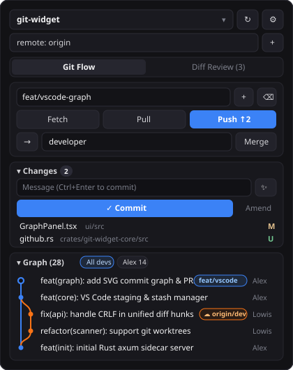
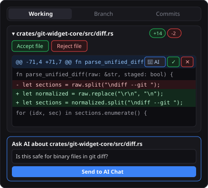

<div align="center">

# Antigravity Git Widget

**Native VS Code-style Source Control, Commit Graph & Per-Hunk AI Diff Review for Antigravity 2.0 (`AUX_PANE`) & T3 Code (Desktop + Mobile Web)**

[](https://www.rust-lang.org/)
[](https://react.dev/)
[](./LICENSE)
[](#installation)

[**English**](./README.md) · [**Русский**](./README.ru.md)

</div>

> [!NOTE]
> **Windows 10/11 only:** Prebuilt binaries (`git-widget-sidecar.exe`) and the multi-host installer currently target **Windows** (`Antigravity 2.0` & `T3 Code`). macOS and Linux builds are not yet provided or tested.

---

## Why This Exists

Antigravity 2.0 orchestrates AI agents outside a traditional IDE, but lacks a native local Git UI. Keeping a heavyweight IDE or external Git client (Fork / GitKraken) open just to run your daily **`checkout → pull → merge → push`** cycle or to review 30+ files touched by an agent wastes RAM and breaks focus.

**Antigravity Git Widget** runs as a single self-contained Rust sidecar binary (~3 MB) embedded directly into Antigravity's right-hand auxiliary pane (`SIDECAR_UI_ENTRYPOINT_AUX_PANE`):

- **Auto-switches repositories** as you switch conversations/projects in Antigravity (`workspace-change` postMessage bridge).
- **VS Code Source Control UX**: split `Staged Changes` & `Changes`, smart commit, `Amend`, `Undo Last Commit`, and `✨ AI Commit Message`.
- **Interactive SVG Commit Graph**: colored branch lanes, branch/tag pills, author filters, expandable commit file inspector, `Cherry-Pick`, and direct GitHub links.
- **Per-Hunk Diff Review & AI Q&A**: accept (`git apply --cached`) or reject (`git apply -R`) individual hunks, or highlight any diff snippet to send a question directly into the active AI chat via `agentapi`.
- **1-Click GitHub Publishing**: create a **Public** or **Private** GitHub repository directly from `Set Remote → Create on GitHub` and push your branch in one step.

---

## Preview

<div align="center">
  
  &nbsp;&nbsp;
  
</div>

---

## Key Features

| Area | Capabilities |
| :--- | :--- |
| **Workspace Sync** | Automatically tracks the active Antigravity project via `workspace-change` + recursive repository scanner (supports standard `.git` dirs and `git worktree` `.git` files). |
| **1-Click Merge & Flow** | `Fetch`, `Pull ↓N`, `Push ↑N`, `Publish Branch`, and directional 1-click `Merge` (`current → target` or `source → current`) with automatic dirty-tree protection (`Stash → Execute → Stash pop`) and `main`/`master` commit previews. |
| **VS Code Changes** | Separate **Staged Changes** and **Changes** lists with per-file `+` (stage), `−` (unstage), `↺` (discard), bulk actions, `Amend`, `Undo Last Commit`, and `✨` AI commit message generation. |
| **SVG Commit Graph** | Multi-lane colored SVG graph, `HEAD` / `local` / `☁ remote` / `tag` pills, **developer filter chips**, commit file stats (`+ins / -del`), `Copy Hash`, `Cherry-Pick`, and `Open on GitHub ↗`. |
| **Diff Review & AI Chat** | Inspect **Working Tree**, **Branch Diff** (`base...HEAD`), or any historical **Commit**. Accept (`✓`) or reject (`✕`) individual hunks or whole files, or click **`💬 AI`** to send any diff snippet + question straight into the active Antigravity conversation. |
| **GitHub & Remotes** | Create a new **Public / Private** GitHub repository from inside the widget (`Create on GitHub`), link existing remotes, or open/create Pull Requests (`+ Create PR ↗`). |
| **T3 Code Integration** | Optional integration into **T3 Code** Desktop & Mobile Web (Tailscale) via non-invasive `boot.cjs` ASAR hook, `/git-widget/*` HTTP proxy, resizable docked drawer, and Task Scheduler auto-repatcher (`--ensure-t3-patched`). |
| **In-App Self-Updater** | Checks GitHub `releases/latest` (6h TTL cache + manual `Check for updates`), shows `Update vX.Y.Z` badge with release notes, verifies `SHA256SUMS.txt`, and updates all installed hosts in 1 click without killing T3 Code or altering `app.asar`. |

---

## Architecture

```text
git-widget/
├── crates/
│   ├── git-widget-core/      # Pure Rust Git engine (git.exe runner, scanner, diff/hunk parser, graph, safety guards)
│   └── git-widget-sidecar/   # Axum HTTP server + rust-embed single-file UI + Antigravity agentapi bridge
├── ui/                       # React 19 + TypeScript + Vite (bundled into a single inline index.html)
├── docs/                     # SVG UI previews
└── install.ps1               # 1-click Windows plugin installer for Antigravity 2.0
```

- **Zero Hang Guarantee**: every `git.exe` invocation runs with `GIT_TERMINAL_PROMPT=0`, `CREATE_NO_WINDOW`, and strict timeouts (10s local / 30s network).
- **Single-Binary Deployment**: the React frontend is compiled via `vite-plugin-singlefile` and embedded into `git-widget-sidecar.exe` using `rust-embed`.

---

## Installation

### Option 1: Single-File Installer (No Rust / Node.js required)

1. Download **`git-widget-sidecar.exe`** from [GitHub Releases](../../releases).
2. **Double-click `git-widget-sidecar.exe`** (or run `.\git-widget-sidecar.exe --install` in PowerShell) and choose your host: **Antigravity 2.0**, **T3 Code**, or **Both** (or pass `--target antigravity|t3code|both`).
3. It installs into `%USERPROFILE%\.gemini\config\plugins\git-widget\` (Antigravity) and/or `%LOCALAPPDATA%\git-widget\` (T3 Code).
4. Restart Antigravity 2.0 / T3 Code or open **Git Widget** in the right pane. Future updates can be installed directly inside the widget via **Update vX.Y.Z → Install & Restart**.

### Option 2: From Source (PowerShell)

### Manual Build from Source

Prerequisites:
- **Rust** (`rustup` with `x86_64-pc-windows-msvc` + VS C++ Build Tools)
- **Node.js 20+** & **npm**
- **Git 2.35+**

```powershell
# 1. Build single-file React UI
cd ui
npm install
npm run build
cd ..

# 2. Run integration tests & build optimized Rust binary
cargo test --workspace
cargo build --release --workspace

# 3. Install into Antigravity 2.0 plugins directory
.\install.ps1
```

---

## Contributing

Contributions, issues, and feature requests are welcome! Please read [CONTRIBUTING.md](./CONTRIBUTING.md) before submitting a Pull Request.

---

## License

Distributed under the [MIT License](./LICENSE).
