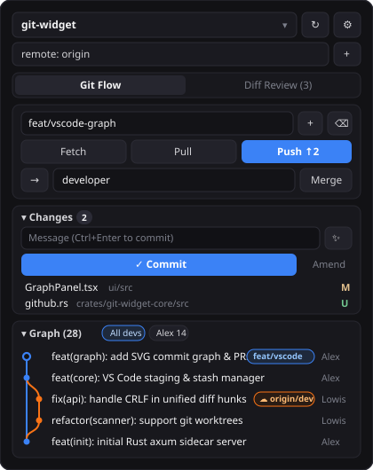
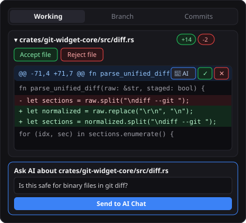

<div align="center">

# Antigravity Git Widget

**Нативный Git-менеджер в стиле VS Code Source Control, граф коммитов и по-hunk'овое Diff-ревью с ИИ для Antigravity 2.0 (`AUX_PANE`)**

[](https://www.rust-lang.org/)
[](https://react.dev/)
[](./LICENSE)
[-3b82f6)](#установка)

[**English**](./README.md) · [**Русский**](./README.ru.md)

</div>

---

## Зачем нужен этот плагин

В Antigravity 2.0 удобно работать с ИИ-агентами, но нет встроенного локального Git UI. Держать рядом тяжёлую IDE или отдельный Git-клиент (Fork / GitKraken) ради рутинного цикла **`checkout → pull → merge → push`** и проверки десятков изменённых агентом файлов накладно по памяти и времени.

**Antigravity Git Widget** работает как единый автономный бинарник на Rust (~3 МБ) прямо в правой шторке Antigravity 2.0 (`SIDECAR_UI_ENTRYPOINT_AUX_PANE`):

- **Автоматически переключает проект** при смене диалога в Antigravity (`workspace-change` postMessage).
- **VS Code Source Control UX**: раздельные секции `Staged Changes` и `Changes`, умный коммит, `Amend`, `Undo Last Commit` и генерация commit message через ИИ (`✨`).
- **Интерактивный SVG-граф коммитов**: цветные линии веток, пилюли веток/тегов, фильтрация по разработчикам, раскрытие файлов коммита, `Cherry-Pick` и прямые ссылки на GitHub.
- **По-hunk'овое Diff-ревью и вопросы ИИ**: принимай (`git apply --cached`) или откатывай (`git apply -R`) отдельные куски (hunk'и) внутри файла, либо выдели любой фрагмент кода и отправь вопрос прямо в открытый чат ИИ в 1 клик.
- **Создание репозитория на GitHub в 1 клик**: если проект только локальный, через `Set Remote → Create on GitHub` можно сразу создать **Public** или **Private** репозиторий в своём аккаунте и запушить ветку.

---

## Превью интерфейса

<div align="center">
  
  &nbsp;&nbsp;
  
</div>

---

## Основные возможности

| Блок | Что умеет |
| :--- | :--- |
| **Синхронизация с проектом** | Мгновенно подхватывает активный проект чата через `workspace-change` + рекурсивно индексирует репозитории (включая `git worktree`). |
| **Цикл `checkout → pull → merge → push`** | `Fetch`, `Pull ↓N` (с тихим фоновым авто-fetch), `Push ↑N`, `Publish Branch` и `Merge` в 1 клик в любом направлении (`текущая → цель` или `источник → текущая`) с защитой `dirty tree` (`Stash → Op → Stash pop`) и превью перед пушем/мерджем в `main`/`master`. |
| **Секция `Changes` (как в VS Code)** | Раздельные списки **Staged Changes** и **Changes** с кнопками `+` (stage), `−` (unstage), `↺` (discard), пакетными действиями, `Amend`, `Undo Last Commit` и кнопкой `✨` для генерации сообщения коммита. |
| **SVG-граф и разработчики** | Цветной граф ветвлений/слияний, пилюли `HEAD` / `local` / `☁ remote` / `tag`, **чипы фильтрации по авторам**, статистика файлов коммита (`+ins / -del`), `Copy Hash`, `Cherry-Pick` и `GitHub ↗`. |
| **Diff Review и связка с чатом ИИ** | Три режима: **Working** (незакоммиченные правки), **Branch** (вся ветка против базовой) и **Commits** (любой коммит из истории). Приём (`✓`) и откат (`✕`) отдельных hunk'ов + кнопка **`💬 AI`** для отправки фрагмента diff с комментарием в открытый чат. |
| **Публикация на GitHub и PRs** | Создание нового **Public / Private** репозитория на GitHub прямо из виджета (`Create on GitHub`), привязка существующих remotes и быстрые кнопки **`+ Create PR ↗`** / **`PRs ↗`**. |

---

## Архитектура

```text
git-widget/
├── crates/
│   ├── git-widget-core/      # Ядро на Rust (безопасный runner git.exe, сканер, парсер diff/hunks, граф, создание репо на GitHub)
│   └── git-widget-sidecar/   # HTTP-сервер на Axum + вшитый через rust-embed single-file UI + мост к Antigravity agentapi
├── ui/                       # React 19 + TypeScript + Vite (собирается в единый автономный index.html)
├── docs/                     # SVG-превью интерфейса
└── install.ps1               # Установщик плагина в 1 команду для Windows
```

---

## Установка

### Быстрая установка (PowerShell)

```powershell
git clone https://github.com/YOUR_USERNAME/git-widget.git
cd git-widget
.\install.ps1
```

Скрипт `install.ps1` соберёт релизный бинарник (если он ещё не собран), скопирует его в `%USERPROFILE%\.gemini\config\plugins\git-widget\` и автоматически пропишет путь текущего пользователя в `sidecar.json`.

### Ручная сборка и запуск тестов

```powershell
# 1. Сборка single-file React UI
cd ui
npm install
npm run build
cd ..

# 2. Прогон интеграционных тестов и сборка релизного бинарника
cargo test --workspace
cargo build --release --workspace

# 3. Установка плагина в Antigravity 2.0
.\install.ps1
```

---

## Участие в разработке

Будем рады PR и идеям! Перед отправкой изменений загляни в [CONTRIBUTING.md](./CONTRIBUTING.md).

---

## Лицензия

Проект распространяется под лицензией [MIT](./LICENSE).
